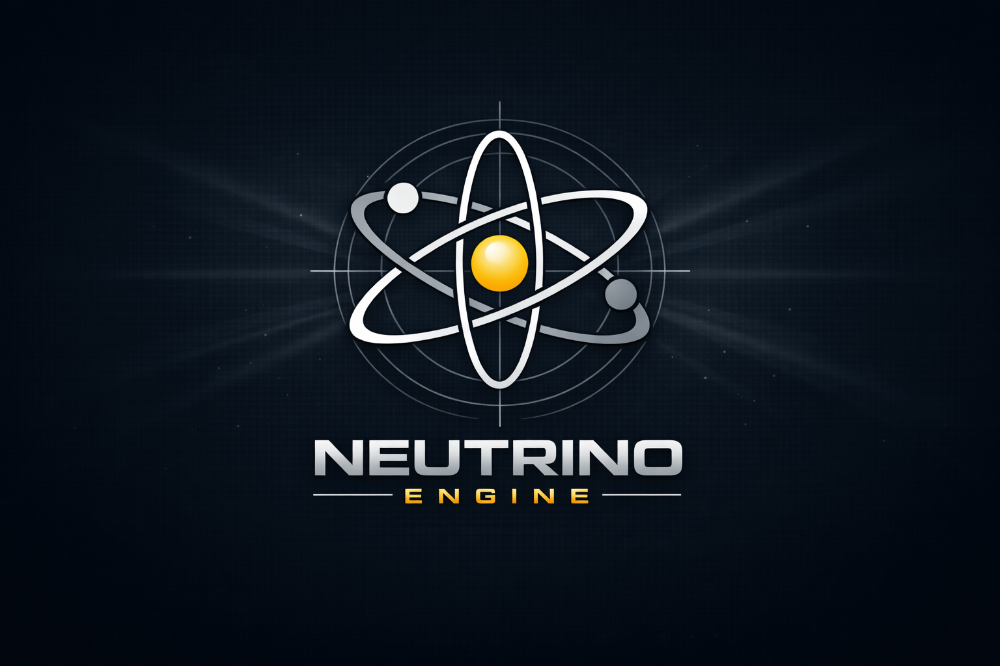

# Neutrino



**Neutrino** is a Real-Time **Rendering and Compute Engine** implemented with **Vulkan** and **C++**.
Neutrino is based on the engine example implementation from the Khronos Vulkan Tutorial (https://docs.vulkan.org/tutorial/latest/00_Introduction.html).

### Note

This repository is for my private training and experiments with computer graphics and gpu compute based on the Vulkan API. It is work in progress and is in a very early state. It is a spare time project.

## Prerequisites

- **CMake** >= 3.20
- **C++20** compatible compiler (MSVC, GCC, Clang)
- **Vulkan SDK** installed and available on system
- **Git** (for submodule support)

## Clone Repository with Submodules

```bash
git clone https://github.com/BernhardKidalka/Neutrino.git
cd Neutrino
git submodule update --init --recursive
```

## Building Neutrino

### Windows (example for Visual Studio 2022)

```
cmake -B build -G "Visual Studio 17 2022"
cmake --build build --config Release
```

### Windows (example for Visual Studio 2026)

```
cmake -B build -G "Visual Studio 18 2026"
cmake --build build --config Release
```

### Linux / macOS (Unix makefiles)

```
cmake -B build -DCMAKE_BUILD_TYPE=Release
cmake --build build
```

### CMake support in IDE's

Modern IDE's like **Visual Studio** or **CLion** provide very good CMake integration and support if you prefer not to configure or build on the command line. Simply open the **CMakeLists.txt in the project root** and wait until the CMake configure step has passed. Afterwards you can build the project in the IDE and run it. Please refer to the online documentation of Visual Studio / CLion to get more help on CMake integration.

I work with **Visual Studio 2026 Community** on **Windows 11** and **CLion 2026.3** on **Ubuntu Linux** and **macOS 27**. The **Neutrino Engine** builds and runs on all three platforms with the same code base.

One hint for **macOS**: macOS has no native support for Vulkan. But you can do Vulkan development on macOS with the **KosmicKrisp** Mesa Vulkan driver, which implements Vulkan 1.4 support based on **Apple's Metal 4 API**. KosmicKrisp comes with the Vulkan SDK installation for macOS (https://vulkan.lunarg.com/sdk/home#mac).

See https://www.lunarg.com/kosmickrisp-achieves-vulkan-1-4-conformance-on-apple-silicon/ for more details.

## Project Structure

```
Neutrino/
├── CMakeLists.txt              # Main CMake configuration
├── third_party/
│   └── glfw/                   # GLFW (window abstraction) - Git submodule
├── engine/
│   ├── CMakeLists.txt          # Engine library configuration
│   ├── include/
│   │    └── engine.h
│   ├── core/
│   │    ├── engine.cpp
│   │    ├── logger.cpp
│   │    └── logger.h
│   ├── platform/
│   │    ├── window.cpp
│   │    └── window.h
│   ├── renderer/
│   │    ├── renderer.cpp
│   │    ├── renderer.h
│   │    ├── renderer_core.cpp
│   │    ├── renderer_pipelines.cpp
│   │    └── renderer_utils.cpp
│   └── resources/
│        ├── memory_pool.cpp
│        └── memory_pool.h
└── src/
    ├── CMakeLists.txt          # Executable configuration
    └── main.cpp
```

## Dependencies

- **Vulkan SDK** - Graphics API (https://vulkan.lunarg.com/)
- **GLFW** (submodule) - Window and input abstraction

You need to install the **Vulkan SDK** on your Dev-PC if you want to build the **Neutrino Engine** project. **GLFW** will be fetched as sub-module when you clone the project.